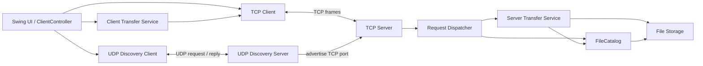
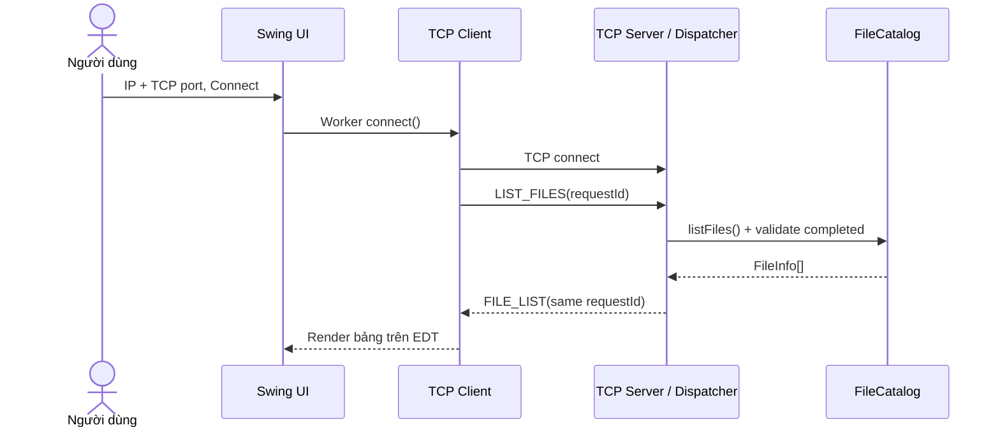
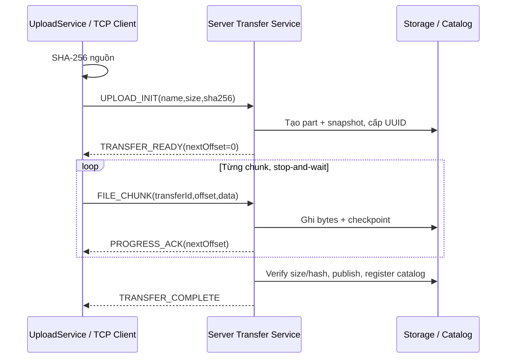
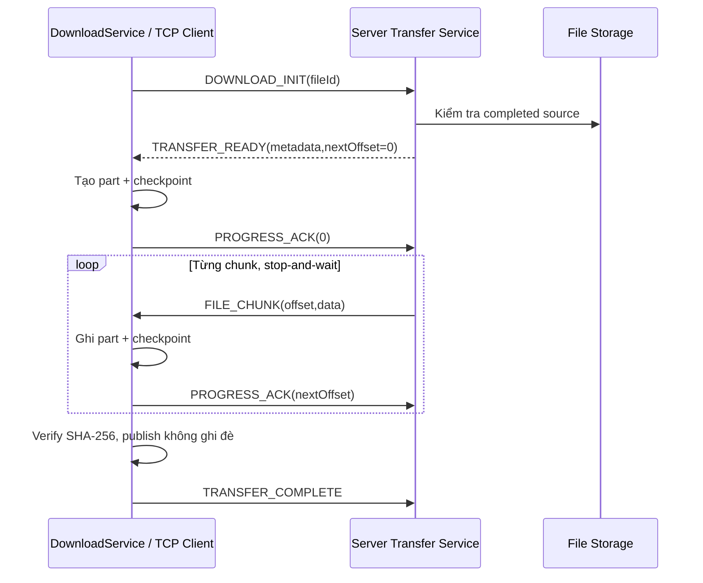

# LAN File Sharing — Chia sẻ file trong mạng LAN

## Giới thiệu và mục tiêu

Ứng dụng Java Swing chia sẻ file giữa nhiều TCP client và một server trong mạng nội bộ. Mục tiêu môn Lập trình mạng: thiết kế framing trên TCP stream, truyền binary có kiểm tra SHA-256, tiếp tục truyền sau ngắt kết nối, xử lý nhiều client và tìm server bằng UDP.

Bản này có chức năng TCP/GUI đã triển khai; trạng thái kiểm chứng cuối cùng nằm trong [báo cáo release](docs/release-review.md). Chưa kết luận **RELEASE READY**: chưa có thông tin thành viên thật, chưa xác minh máy mới/JDK 21 runtime/LAN hai máy và source benchmark đang thiếu trong checkout.

## Thành viên và đóng góp

Chưa được cung cấp họ tên/MSSV xác thực. Nhóm phải điền trước khi nộp; không suy ra danh tính từ username máy hoặc Git author.

| Nhãn phân công trong repository | Phạm vi có tài liệu |
|---|---|
| TV1 | TCP server, framing/common |
| TV2 | Server transfer, storage, SHA-256/resume |
| TV3 | TCP client và client transfer |
| TV4 | Swing UI và UDP discovery |

TV1–TV4 là **vai trò kế hoạch**, không khẳng định có bốn sinh viên. Starter quy định tối đa ba sinh viên/nhóm; cần ánh xạ vai trò vào danh sách thật và xác nhận đóng góp. Không quy phần HTTP/benchmark chưa có source thành thành tích đã hoàn thành.

## Công nghệ

Java 21 target; JDK 21+ để build; Swing/AWT; java.net TCP/UDP; NIO FileChannel; SHA-256; Jackson Databind 2.18.3; Maven 3.9+ multi-module; JUnit Jupiter 5.12.1; Surefire 3.5.2; Compiler Plugin 3.13.0. Launcher Windows dùng PowerShell 5.1+. Python 3.11+ chỉ cần cho công cụ xác minh release, không cần để chạy ứng dụng.

## Chức năng thực tế

- Kết nối IP/TCP port thủ công, LIST_FILES, refresh catalog.
- Upload/download file binary, rỗng, tên Unicode; tên trùng phân biệt bằng UUID.
- Kiểm tra size/SHA-256 trước công bố completed; file tạm không xuất hiện trong catalog.
- Checkpoint, reconnect và resume hai chiều với offset hợp lệ trong cùng tiến trình server.
- Executor server có giới hạn; mặc định 32 kết nối; một transfer trên một socket.
- UDP discovery, lựa chọn server tường minh, hủy tìm kiếm và fallback nhập IP.
- Swing hiển thị tiến độ, tốc độ, trạng thái, Activity log; hash/socket/file I/O chạy ngoài EDT.
- Báo lỗi protocol/offset/hash/file I/O có kiểm soát; không ghi đè destination download.

HTTP/browser download, TLS, đăng nhập, khôi phục resume sau server restart và benchmark có source tái lập **chưa hoàn thành trong checkout hiện tại**.

## Kiến trúc Client–Server



Mỗi client có một reader cho socket, xử lý request tuần tự. Server dùng thread pool có giới hạn; transfer manager dùng lease theo session/transfer và khóa theo entry. Catalog chỉ chứa file completed đã kiểm chứng. Storage lưu theo UUID, không ghép tên file do client cung cấp vào đường dẫn.

## TCP protocol format và message types

Frame: `[length: int32 big-endian][type: uint8][payload: length-1 bytes]`. Length bao gồm type, không bao gồm bốn byte header, hợp lệ 1..1048576. TCP không giữ ranh giới message; codec phải đọc đủ header/payload. Frame lỗi/type không biết/EOF giữa frame làm đóng socket.

Control payload là JSON UTF-8 tối đa 65536 byte, có `protocolVersion:1`, `requestId` UUID. Reply phải khớp requestId. FILE_CHUNK dùng binary: `transferId:16 bytes | offset:int64 | dataLength:int32 | data`, big-endian; dataLength 1..65536. File rỗng không gửi chunk.

| Hex | Message | Ý nghĩa |
|---|---|---|
| 01 | LIST_FILES | Yêu cầu catalog completed |
| 02 | FILE_LIST | files gồm fileId/name/size/sha256 |
| 03 | UPLOAD_INIT | name, size, sha256 |
| 04 | DOWNLOAD_INIT | fileId |
| 05 | TRANSFER_READY | transferId, direction, fileId, name, size, sha256, nextOffset |
| 06 | FILE_CHUNK | Binary data và offset |
| 07 | PROGRESS_ACK | transferId, nextOffset bên nhận đã ghi |
| 08 | RESUME_QUERY | transferId, direction, fileId, size, sha256 |
| 09 | TRANSFER_COMPLETE | transferId, fileId, size, sha256 |
| 0A | ERROR | code, message, transferId tùy chọn |

Sai offset trả OFFSET_MISMATCH; hash sai trả HASH_MISMATCH; file không có trả NOT_FOUND; quá tải trả SERVER_BUSY nếu gửi được response tương quan. Chi tiết validation/error codes tại [đặc tả giao thức](docs/protocol.md). Không mở cổng TCP này bằng HTTP/browser.

## UDP Discovery protocol

Mặc định UDP 49001, TCP 49000. Request ASCII `LANFS_DISCOVER/1 <nonce>`; response `LANFS_HERE/1 <nonce> <tcpPort>`. Nonce là 32 hex chữ thường, tối đa 128 byte/gói. Client kiểm tra version/nonce/port, lấy IP từ nguồn packet và loại trùng endpoint. Timeout 800 ms/lần, tối đa ba lần. Broadcast theo interface; không bảo đảm qua router hoặc Wi-Fi guest isolation. Discovery không tự kết nối, kể cả chỉ có một kết quả.

## Connect / LIST_FILES sequence



## Upload sequence



## Download sequence



## Resume sequence

```mermaid
sequenceDiagram
  participant C as Client Transfer Service
  participant S as Server Transfer Service
  C--xS: Socket bị ngắt
  Note over C,S: Giữ part/checkpoint; chờ lease cũ được thu hồi
  C->>S: TCP reconnect
  C->>S: RESUME_QUERY(id,direction,fileId,size,sha256)
  S->>S: Kiểm tra metadata, TTL, ownership, nguồn/prefix
  S-->>C: TRANSFER_READY
  alt Upload
    Note over C,S: Server trả offset đã nhận hợp lệ
    C->>S: FILE_CHUNK từ nextOffset
    S-->>C: PROGRESS_ACK
  else Download
    C->>C: Kiểm tra checkpoint/part local
    C->>S: PROGRESS_ACK(offset local)
    S->>C: FILE_CHUNK từ offset bên nhận
    C-->>S: PROGRESS_ACK
  end
  Note over C,S: Đủ byte → verify hash → publish → COMPLETE theo chiều truyền
```

Resume giữ ID, không tạo file mới/replay toàn bộ. Session hết hạn sau 24 giờ từ hoạt động cuối, chỉ tồn tại trong cùng tiến trình server. Không restart server giữa disconnect/reconnect. ACK là offset đã ghi mức ứng dụng, không cam kết fsync chống mất điện.

## Cấu trúc repository

```text
README.md
INSTRUCTION.md                 # nguyên bản giảng viên, không chỉnh sửa
statics/results/               # CSV và bằng chứng thật
source/
  pom.xml                      # parent reactor, Java release 21
  common/                      # framing, DTO, hash, UDP protocol
  server/                      # network, transfer, storage, discovery
  client/                      # network, transfer, ui, discovery
  experiments/                 # POM + tài liệu; tools kiểm tra release
docs/                          # báo cáo và đặc tả bổ trợ
scripts/java-launch.ps1        # helper vận chuyển Unicode CLI args
build.ps1
run-server.ps1
run-swing.ps1
run-client.ps1                  # CLI LIST_FILES
run-upload.ps1 / run-download.ps1 / run-discovery.ps1
run-resume-demo.ps1 / run-resume-upload.ps1 / run-resume-download.ps1
```

Toàn bộ Java source và công cụ Python đặt dưới source/. Các PS1 root là launcher/build tiện ích. Runtime/cache/target không nộp như source. [Module common](source/common/README.md), [server](source/server/README.md), [client](source/client/README.md), [experiments](source/experiments/README.md).

## Môi trường và build trên máy mới

1. Clone repository nhóm bằng URL thật do nhóm cung cấp, vào thư mục chứa README này. Không dùng URL starter để clone ứng dụng đã hoàn thiện.
2. Cài JDK **21** (khuyến nghị) hoặc mới hơn, Maven **3.9+**, đặt JAVA_HOME/PATH. Kiểm tra cả hai lệnh cùng dùng JDK mong muốn:
   ```powershell
   java -version
   mvn -version
   ```
3. Từ root:
   ```powershell
   .\build.ps1 clean package
   ```
   Lần đầu cần Internet cho Maven Central. Script dùng cache tương đối `.m2/repository` trong dự án; không chứa đường dẫn máy phát triển. Chờ BUILD SUCCESS.
4. Nếu PowerShell chặn script, cho phép **chỉ phiên hiện tại** theo quy định máy:
   ```powershell
   Set-ExecutionPolicy -Scope Process -ExecutionPolicy Bypass
   ```

Build Maven trực tiếp: `mvn -f source/pom.xml clean package`. Lệnh này dùng cache Maven mặc định; để dùng các launcher PS1 đi kèm, build bằng build.ps1 để runtime Jackson jars có trong cache dự án. JAR hiện tại là thin JAR, **không chạy bằng java -jar**; launcher ghép classpath đủ common/Jackson. Không cần exec-maven-plugin để chạy.

Trong môi trường kiểm chứng này Clean Plugin chưa có trong cache và tải mạng bị chặn; lệnh clean trên máy mới **chưa được xác minh**. Khi cache đã đủ, dùng `.\build.ps1 -Offline package` để không tải mạng; `-SkipTests` chỉ dùng khi đã có kết quả test cho cùng source. Build từ source không có target được kiểm tra riêng trong báo cáo. Chưa có JDK 21 runtime cài tại máy này: kiểm tra bytecode Java 21 không thay thế chạy trực tiếp trên JDK 21.

## Chạy server và Swing client

Mở hai terminal tại root; cần build trước.

```powershell
# Terminal 1
.\run-server.ps1 -BindAddress 0.0.0.0 -Port 49000 -UdpPort 49001 -StorageDirectory runtime/server
# Terminal 2: cùng máy
.\run-swing.ps1 -ServerHost 127.0.0.1 -Port 49000 -UdpPort 49001
```

Server in TCP listening và UDP discovery listening (nếu bind được). GUI có tab Server files, Transfers, Activity log. Dùng Ctrl+C để dừng server; đóng GUI theo nút cửa sổ. Không dừng mọi java.exe vì có thể ảnh hưởng ứng dụng khác. Server launcher đã kiểm chứng qua process thật; MainFrame/luồng GUI đã qua DesktopSmokeTest. Lượt kiểm tra riêng run-swing.ps1 khởi động đúng JVM nhưng không xác nhận được external window title/đóng bình thường trong môi trường quản lý này, nên cần chạy thử trực tiếp trên desktop trước release; xem receipt trong báo cáo.

### Cấu hình

| Thành phần | Tùy chọn / mặc định |
|---|---|
| Server bind | -BindAddress 0.0.0.0; loopback riêng dùng 127.0.0.1 |
| TCP | -Port 49000 ở cả server/client |
| UDP | -UdpPort 49001 ở server/GUI/discovery |
| Storage | -StorageDirectory runtime/server, phải ngoài source/ |
| Giới hạn server | -MaxConnections 32, -TimeoutMillis 30000, -MaxFileBytes 1073741824 |
| UDP tùy chọn | -DisableDiscovery; UDP bind lỗi không làm ngừng TCP |
| Client checkpoint | -CheckpointDirectory runtime/client trên GUI/upload/resume |
| Địa chỉ server | -ServerHost hoặc nhập trong GUI; máy B dùng IPv4 máy A |

Log server ra stdout/stderr; GUI có Activity log. Khi thu log tự động phải gom stdout/stderr ở cấp process hoặc cẩn thận NativeCommandError của Windows PowerShell khi redirect Java logger. File part/snapshot ở runtime storage hoặc cạnh destination download; không đặt dữ liệu runtime trong source hay commit vào Git.

### Các thao tác

1. **Discover**: chọn UDP port, Discover, chọn endpoint rõ ràng; hoặc nhập Server IP/TCP port.
2. **Connect**: GUI kết nối và tải danh sách; **Refresh** để LIST_FILES lại.
3. **Upload file**: chọn regular file đọc được; chờ Completed sau verify server.
4. **Download selected**: chọn hàng, chọn đường dẫn mới có parent tồn tại; không ghi đè.
5. **Verify**: Completed chỉ sau kiểm tra SHA-256. Kiểm tra độc lập:
   ```powershell
   Get-FileHash .\runtime\input.bin, .\runtime\received.bin -Algorithm SHA256
   ```
6. **Resume**: truyền file lớn → Disconnect → đợi Interrupted → Connect cùng endpoint → chọn hàng Interrupted trong Transfers → Resume selected. Giữ GUI và server đang mở.
7. **Nhiều client**: mở 4/8 terminal chạy run-swing.ps1; mỗi cửa sổ một connection. Server quá tải có thể trả SERVER_BUSY; không hứa băng thông tăng tuyến tính.

CLI hỗ trợ demo:
```powershell
.\run-client.ps1 -ServerHost 127.0.0.1 -Port 49000
.\run-discovery.ps1 -TargetHost 127.0.0.1 -UdpPort 49001 -ConnectIndex 1
.\run-upload.ps1 -LocalFile README.md -ServerHost 127.0.0.1 -Port 49000
# Thay UUID bằng fileId thật từ kết quả upload/LIST_FILES:
.\run-download.ps1 -FileId '<UUID-thật>' -Destination runtime/received.md -ServerHost 127.0.0.1 -Port 49000
```

## Demo hai máy LAN và Windows Firewall

Máy A chạy server bind 0.0.0.0; lấy IPv4 adapter LAN thực bằng ipconfig. Máy B chạy:
```powershell
.\run-swing.ps1 -ServerHost 192.168.1.20 -Port 49000 -UdpPort 49001
Test-NetConnection 192.168.1.20 -Port 49000
```
192.168.1.20 chỉ là ví dụ, thay bằng IP thật. Cả hai dùng cùng revision, cùng mạng tin cậy; không nhập 127.0.0.1 trên B để truy cập A.

Nếu Windows Firewall chặn, quản trị viên máy A thêm rule giới hạn Private/LocalSubnet:
```powershell
New-NetFirewallRule -DisplayName 'LANFS demo TCP' -Direction Inbound -Action Allow -Protocol TCP -LocalPort 49000 -Profile Private -RemoteAddress LocalSubnet
New-NetFirewallRule -DisplayName 'LANFS demo UDP' -Direction Inbound -Action Allow -Protocol UDP -LocalPort 49001 -Profile Private -RemoteAddress LocalSubnet
```
Không tắt toàn bộ firewall. Đổi port thì đổi rule; chỉ gỡ các rule này khi không dùng nữa bằng Remove-NetFirewallRule -DisplayName tương ứng. Nếu broadcast bị chặn, nhập IP thủ công hoặc thử UDP unicast. LAN hai máy/firewall commands là **quy trình chưa thực thi ở môi trường này**, không phải kết quả PASS.

### Kịch bản demo và expected result

| Bước | Thao tác | Expected result |
|---|---|---|
| 1 | Build, start server storage riêng | BUILD SUCCESS, listening đúng port, không lỗi bind |
| 2 | Start Swing client | Cửa sổ mở, thao tác không treo EDT |
| 3 | Discover UDP, chọn server | Hiện IP/TCP port; chưa tự connect |
| 4 | Connect | Connected, LIST_FILES tải được |
| 5 | Refresh | Chỉ thấy completed files |
| 6 | Upload file binary | Progress cập nhật, Completed sau verify; có UUID |
| 7 | Verify SHA nguồn và completed của server | Hai hash bằng nhau |
| 8 | Download vào tên mới | Completed, không ghi đè file cũ |
| 9 | Get-FileHash nguồn và bản nhận | SHA-256 bằng nhau |
| 10 | Upload/download file 100 MiB, bấm Disconnect giữa chừng | Interrupted, giữ transferId/offset/checkpoint |
| 11 | Connect lại cùng server | TCP hoạt động, không restart server |
| 12 | Resume selected | Tiếp tục offset hợp lệ, Completed, hash đúng |
| 13 | Mở nhiều client, cắt riêng một client | Các client còn lại tiếp tục, server còn LIST_FILES được |
| 14 | Activity log/server log, CSV thực | Có request/transfer/offset/trạng thái; phân biệt số liệu localhost/partial |

Muốn demo cắt socket hai chiều tự động: `./run-resume-demo.ps1 -LocalFile runtime/input.bin -Destination runtime/resumed.bin -ServerHost 127.0.0.1 -Port 49000`; nguồn ít nhất 1 MiB, nên dùng 100 MiB; destination chưa tồn tại. Demo này dùng socket thật, không restart server. Bước benchmark chỉ xem dữ liệu cũ hiện có, **chưa có source benchmark để chạy lại**.

Ảnh thực từ DesktopSmokeTest localhost: [cửa sổ upload/download completed](statics/screenshots/phase10-desktop-localhost.png). Ảnh được test render từ cửa sổ Swing thật sau kiểm tra hash; không phải bằng chứng LAN. Chụp thêm ảnh hai máy khi chạy demo LAN.

## Test cases và kết quả thực nghiệm

Chạy `./build.ps1 test` hoặc `./build.ps1 package` (package đã bao gồm test). Test thật bao phủ framing, TCP connect/refused/timeout, LIST_FILES, binary upload/download, hash mismatch, resume, offset sai, 1/4/8 client, overload, UDP discovery/failure và Swing controller/EDT. DesktopSmokeTest mở GUI thật khi có display; nếu headless sẽ skip và phải ghi BLOCKED.

Kết quả bản cuối: [JUnit CSV](statics/results/phase10-junit.csv), [bằng chứng build/run](statics/results/phase10-validation.json), [review/checklist](docs/release-review.md). Không dùng số test ở báo cáo phase cũ để đại diện bản cuối.

Các CSV phase09 còn ở statics/results là **179 mẫu / 43 batch localhost**, 179 mẫu success/hash=true; lượt đo bị ngắt trước đủ 234 mẫu/54 batch dự kiến. Không có download 100 MiB trong dữ liệu này; upload 100 MiB với 8 client chỉ có một batch. Median throughput từng client ở upload 100 MiB: 1 client **9,806 MiB/s** (3 mẫu), 4 client **4,761 MiB/s** (12 mẫu), 8 client **3,404 MiB/s** (8 mẫu cùng một batch). Đây là dữ liệu lịch sử, không phải phép đo LAN hoặc benchmark tái lập từ source checkout hiện tại. Không cộng throughput batch vào throughput từng client và không suy luận nhanh/chậm từ một batch.

## Hạn chế và hướng phát triển

- Chưa có TLS/login/quota: chỉ dùng mạng nội bộ tin cậy.
- Resume không qua server restart; UI history không bền vững sau đóng GUI; checkpoint upload cũ chưa tự dọn.
- LIST_FILES tính lại hash, không pagination; catalog lớn có thể chậm/quá JSON 64 KiB.
- Stop-and-wait ACK và disk/checkpoint/hash có chi phí; chưa tối ưu pipeline/throughput.
- Download publish cần hard link; chưa xác minh mọi filesystem; không bảo đảm chống mất điện.
- Chưa kiểm tra LAN thật, JDK 21 runtime, tải dependency trên máy hoàn toàn mới và soak nhiều giờ.
- Source benchmark còn thiếu; cần hoàn thiện trước khi tuyên bố đầy đủ thực nghiệm.
- HTTP browser download là hướng phát triển tùy chọn, chưa có server HTTP trong code.

Ưu tiên tiếp theo: hoàn thiện benchmark tái lập, kiểm thử hai máy/JDK 21, metadata cleanup client, pagination; sau đó mới xét TLS/xác thực và tối ưu throughput.

## Tài liệu tham khảo và quy định nộp

- [Starter chính thức của giảng viên](https://github.com/hungdn1701/jnp-project-starter); [INSTRUCTION.md nguyên bản](INSTRUCTION.md), lấy từ nhánh main, không chỉnh nội dung.
- [Java 21 API](https://docs.oracle.com/en/java/javase/21/docs/api/), [Swing concurrency](https://docs.oracle.com/javase/tutorial/uiswing/concurrency/).
- [Maven lifecycle](https://maven.apache.org/guides/introduction/introduction-to-the-lifecycle.html), [JUnit 5](https://docs.junit.org/5.12.1/user-guide/), [Jackson Databind](https://github.com/FasterXML/jackson-databind).
- [Đặc tả local](docs/protocol.md) và [review release](docs/release-review.md); báo cáo phase1–8 là lịch sử, có giới hạn cũ không còn áp dụng cho bản hiện tại.

Các thay đổi tài liệu, build và bằng chứng được chốt trên nhánh `chore/release-documentation` để merge cục bộ vào `main` theo yêu cầu. Push, tag hoặc tạo GitHub release cần yêu cầu riêng. Trước nộp: điền thành viên/MSSV/đóng góp thật, xác minh clean build và JDK 21/máy mới, chạy LAN nếu yêu cầu, khôi phục source benchmark và chụp ảnh thật. Chỉ công bố RELEASE READY sau khi các mục bắt buộc được kiểm chứng và không còn blocker.
