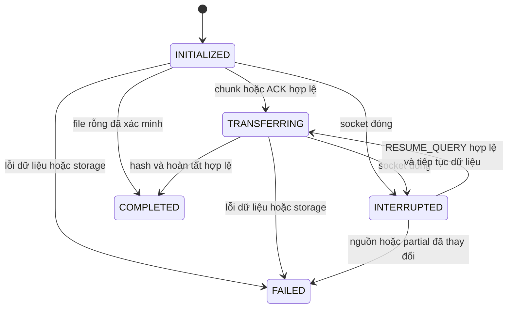

# Phase 5 — Resume & Reconnect

## A. Phạm vi và nhánh

Triển khai tại `feature/tv2-upload-server`, fast-forward từ `main` sau Phase 4 (`7cd96f8`). Theo phân công README, TV2 phụ trách session, `.part`, hash/resume; có tích hợp client của TV3. TV1 phụ trách TCP framing. Chưa commit/merge để người dùng kiểm thử.

Resume upload/download trên kết nối TCP mới, cùng transferId/fileId và requestId mới. Không đổi MessageType, ErrorCode, FrameCodec, JSON DTO hoặc binary FILE_CHUNK trong hợp đồng v1. Không triển khai Swing, UDP hoặc khôi phục session sau server restart.

## B. Các file thay đổi

Đường dẫn Java dưới package `vn.edu.lanfileshare` của từng module:

| Module | File tạo mới | File chỉnh sửa |
| --- | --- | --- |
| common | `io/PrefixHash`, `io/PayloadMetrics`; test `io/PrefixHashTest` | Không |
| server/network | Không | `ClientSession`, `SessionContext`, `TcpServer` |
| server/transfer | `ManagedTransfer`, `TransferSessionManager`; test `TransferSessionManagerTest` | `TransferSession`, `DownloadSession`, `TransferCoordinator`, `UploadHandler`, `DownloadHandler`, `TransferSnapshot`, `TransferStateStore` |
| client/network | `ClientState`, `ReconnectPolicy`, `TransferFailures` | `TcpClient`, `ClientConnection` |
| client/transfer | `CheckpointLocks`, `DownloadCheckpoint`, `ResumeAttempts`, `ResumeResult`, `TransferInterruptedException`, `UploadCheckpoint`, `UploadCheckpointStore` | `UploadService`, `DownloadService`, `DownloadFile`, `TransferStatus` |
| client entry point | `ResumeUploadMain`, `ResumeDownloadMain`, `ResumeDemoMain` | `UploadMain` |
| client test | `ReconnectPolicyTest`, `ResumableTransferIntegrationTest`, `transfer/UploadCheckpointStoreTest` | Không |
| Repository | `run-resume-upload.ps1`, `run-resume-download.ps1`, `run-resume-demo.ps1`, `docs/phase5.md` | `run-upload.ps1`, `README.md` |

## C. State machine, metadata và luồng xử lý



`TransferSessionManager` giữ registry trong RAM, đồng bộ truy cập và cấp một owner lease cho mỗi transfer. Claim khi socket cũ chưa nhả lease trả `SERVER_BUSY`; release từ owner cũ không ảnh hưởng owner mới. Query sai metadata không thay đổi phiên đúng. COMPLETED/FAILED không được resume; session không tồn tại/hết hạn trả `TRANSFER_NOT_FOUND`, metadata không khớp trả `TRANSFER_CHANGED`.

Server lưu snapshot JSON qua `TransferStateStore` trong thư mục runtime cấu hình sẵn: transferId, fileId, direction, metadata, nextOffset, state, lastActivityTime; upload bổ sung SHA-256 của prefix đã ghi. UUID quyết định đường dẫn staging `.part`, không dùng name từ client để tạo đường dẫn. JSON trên đĩa phục vụ theo dõi và thu gom, **không được nạp lại thành session sau restart**.

TTL là 24 giờ từ hoạt động thực tế cuối cùng. Đọc snapshot không kéo dài TTL. Kiểm tra khi claim và janitor chạy mỗi phút. Hết hạn sẽ đóng handle, xóa metadata truyền và upload staging; không xóa file completed hoặc catalog. Snapshot cũ hợp lệ từ tiến trình trước có thể được thu gom khi hết hạn, không phục hồi transferId. JSON hỏng được log và bỏ qua an toàn.

Upload client lưu checkpoint JSON atomically ở `<checkpointDirectory>/uploads/<transferId>.json`. API mặc định dùng `java.io.tmpdir/lanfs-client`; script dùng `runtime/client`. Download giữ `.part` và `.part.json` cạnh đích người dùng chọn: metadata, tên đích local, offset và hash prefix. Reader/writer của các instance dùng khóa chung để tránh lỗi thay thế file đang mở trên Windows. Client từ chối checkpoint quá 24 giờ; chưa có janitor tự xóa checkpoint client.

### Upload resume

1. Khi mất socket, server đóng handle và giữ session INTERRUPTED; client lưu checkpoint và ném `TransferInterruptedException` chứa transferId, checkpoint, nextOffset.
2. Client kiểm tra toàn bộ size/SHA-256 nguồn chưa thay đổi trước RPC, reconnect có giới hạn và gửi `RESUME_QUERY(UPLOAD, transferId, fileId, size, sha256)`.
3. Server xác minh session, TTL, metadata, `.part` regular không symlink, kích thước và SHA-256 prefix đã commit. Tail chưa commit được truncate sau khi prefix hợp lệ; partial thiếu/ngắn/hỏng bị từ chối.
4. `TRANSFER_READY(nextOffset)` là offset authoritative phía server. Client seek đến đó, gửi phần còn thiếu, chờ ACK mỗi chunk.
5. Đủ size thì server tính SHA-256 toàn file, cập nhật catalog và gửi `TRANSFER_COMPLETE`. Client chỉ trả thành công sau xác nhận này. Nếu server đã có đủ byte nhưng chưa complete, resume không cần chunk mới và vẫn verify/finalize.

### Download resume

1. Client kiểm tra checkpoint, `.part`, prefix hash, TTL và đích chưa tồn tại trước RPC.
2. Gửi `RESUME_QUERY(DOWNLOAD, ...)`. Server mở lại cùng file completed và xác minh full hash/metadata trên handle nguồn.
3. Server gửi READY rồi **chờ ACK khởi đầu**, tuyệt đối chưa gửi FILE_CHUNK.
4. Client truncate tail chưa commit, mở partial và ACK offset đã ghi. Offset này có thể lớn hơn ACK server ghi nhận trước disconnect vì ACK cuối có thể mất.
5. Server seek theo ACK đầu hợp lệ trong `[0, size]`; gửi từng chunk và chỉ tiếp tục sau ACK đúng cuối chunk đang chờ.
6. Client verify size/full SHA-256, công bố bằng cơ chế không ghi đè của Phase 4, gửi `TRANSFER_COMPLETE` rồi trả kết quả. Protocol v1 không có ACK server cho thông báo hoàn tất download.

### Offset và tính toàn vẹn

`nextOffset` luôn là byte đầu tiên chưa ghi xong. Server ghi chunk đúng offset → cập nhật prefix/offset → lưu snapshot thành công → mới ACK. Khi lưu metadata thất bại, rollback offset và truncate dữ liệu chưa commit. Các thao tác session được đồng bộ.

Chunk hoàn toàn trước nextOffset không ghi lại, chỉ ACK offset hiện tại. Chunk chồng lấn, nhảy cóc hoặc vượt size bị từ chối. FILE_CHUNK length vẫn được codec v1 kiểm tra. Download ghi dữ liệu và checkpoint trước progress callback/ACK; vì vậy test có thể ngắt tại biên ghi xác định. Resume không tin riêng kích thước `.part`: kiểm tra prefix hash, rồi vẫn kiểm tra hash toàn bộ trước công bố.

Client phân biệt CONNECTED, DISCONNECTED, TRANSFERRING, INTERRUPTED, RESUMING, COMPLETED, FAILED. `isConnected()` phản ánh socket riêng. Reconnect mặc định tối đa 3 lần, backoff 100/200 ms, trần 1 giây; policy cấu hình được và có giới hạn. Resume chỉ retry `SERVER_BUSY` có giới hạn để chờ lease cũ được nhả; không retry lỗi integrity hoặc tự gửi INIT từ byte 0. Test inject delay hook, không dùng sleep ngẫu nhiên để ngắt truyền.

## D. Build và chạy thử

Đã chạy tại root repository:

```powershell
.\build.ps1 compile test package
```

JDK 23.0.1, Maven 3.9.11, compile release 21. Để tự chạy demo, dùng file có sẵn từ 1 MiB trở lên và destination mới:

```powershell
# Terminal 1; nếu server cũ đang chạy, dừng bằng Ctrl+C và chạy bản mới
.\run-server.ps1

# Terminal 2
New-Item -ItemType Directory -Force runtime/downloads | Out-Null
.\run-resume-demo.ps1 -LocalFile 'D:\data\sample.bin' -Destination runtime/downloads/resumed.bin
```

Demo tự đóng socket tại khoảng 30% upload và 40% download qua progress callback, reconnect/resume cùng IDs, in byte payload trước/sau và kiểm tra byte-for-byte/hash. Đích đã tồn tại sẽ bị từ chối. Thay file nguồn bằng file trên máy mình; không dùng README nhỏ hơn 1 MiB cho demo này.

Hai CLI tiếp tục một phiên thực sự đã gián đoạn, lấy ID/checkpoint từ exception hoặc file local:

```powershell
.\run-resume-upload.ps1 -TransferId '<uuid>' -CheckpointDirectory runtime/client
# Có thể thêm -LocalFile 'D:\data\sample.bin' để chỉ định lại nguồn có cùng size/hash.
.\run-resume-download.ps1 -TransferId '<uuid>' -CheckpointFile '<duong-dan-.part.json>'
```

Thêm `-ServerHost <IP LAN> -Port <port>` cho cả ba script nếu cần. Không dùng ID đã completed của demo để resume lần nữa. Server phải còn cùng tiến trình và session còn TTL.

## E. Kết quả thực tế

**PASS — 118 test, 0 failure/error/skipped:** common 14, server 25, client 79. Reactor parent/common/server/client/experiments BUILD SUCCESS; lệnh compile/test/package hoàn tất lúc `2026-11-04T01:00:47+07:00`. Giữ toàn bộ test upload/download/list cũ.

Test mới dùng socket thật và điểm ngắt xác định, condition chờ lease detach, Clock giả cho TTL. Bao phủ resume hai chiều, nhiều lần ngắt, ID không tồn tại, sai size/hash/direction/fileId, nguồn đổi, partial mất/hỏng, tail chưa commit, duplicate/overlap/gap/overflow, hết hạn, terminal không resume, đồng thời claim, restart không phục hồi, ACK download khởi đầu và ACK sai, reconnect có giới hạn, Windows checkpoint reader/writer. Không dùng mock thay thế E2E.

`source/client/target/resume-evidence.json` ghi số đo integration 10 MiB: upload 3 MiB + 7 MiB, download 4 MiB + 6 MiB. Download ngắt sau ghi nhưng trước ACK cuối; vẫn tiếp tục đúng offset local, không replay chunk đã ghi. `PayloadMetrics` chỉ đếm data bytes của FILE_CHUNK hoàn chỉnh, không cộng header/control JSON; không phải số byte vật lý TCP hoặc benchmark tốc độ.

Smoke riêng chạy server/client JAR với **heap 32 MiB mỗi tiến trình**, nguồn **100 MiB**, socket thật:

| Hướng | Trước ngắt | Sau reconnect | Tổng data payload | Resume offset |
| --- | ---: | ---: | ---: | ---: |
| Upload | 31,457,280 | 73,400,320 | 104,857,600 | 31,457,280 |
| Download | 41,943,040 | 62,914,560 | 104,857,600 | 41,943,040 |

Byte-for-byte và SHA-256 khớp: `3d04020ff36139b3121595a8088c1a227aac8d1b10eea02a157788253e87c762`. Không OOM; không suy diễn đây là kiểm thử giới hạn 1 GiB. Bằng chứng local: `runtime/phase5-smoke-9e49cee2/evidence.json`. Cũng đã chạy `run-resume-demo.ps1` với 10 MiB thành công.

Hai script resume riêng được chạy bằng checkpoint của phiên socket thật bị đóng sau 65,536 byte: mỗi hướng tiếp tục 983,040 byte còn lại của file 1,048,576 byte; exit code 0, bytes/hash khớp. Bằng chứng: `runtime/phase5-cli-0c30cc2d/evidence.json`. Các server smoke riêng đã được dừng và giải phóng tài nguyên. Runtime/target bị Git ignore, không phải fixture cần commit.

## F. Giới hạn

- Không resume qua server restart, không có transaction phân tán hay cam kết fsync chống mất điện; ACK xác nhận ghi ở mức ứng dụng theo v1.
- Mất xác nhận hoàn tất sau khi server đã COMPLETED không cho resume terminal; đối chiếu LIST_FILES để xử lý trạng thái không chắc chắn, không tự upload lại.
- Download v1 chỉ có COMPLETE client → server, không thêm response xác nhận ngoài protocol. Việc publish và gửi TCP không thể atomic với nhau.
- Publish download giữ chính sách Phase 4: không ghi đè, dùng hard link trên filesystem hỗ trợ (đã kiểm thử NTFS), thất bại an toàn nếu không hỗ trợ. Không tự đổi sang overwrite.
- Hash toàn nguồn/prefix khi resume tốn I/O tuyến tính nhưng bộ nhớ giới hạn. Chưa triển khai quota tổng số session hoặc janitor checkpoint client. Server không cung cấp xác thực ngoài phạm vi v1; cần môi trường LAN tin cậy.

## G. API cho phase tiếp theo

```java
TcpClient.reconnect();
TcpClient.reconnect(ReconnectPolicy policy);
TcpClient.state();
TcpClient.metrics();

UploadService.resumeUpload(UUID transferId, ProgressListener<UploadProgress> listener);
UploadService.resumeUpload(UUID transferId, Path source, ProgressListener<UploadProgress> listener);
// Overload thêm ReconnectPolicy.
DownloadService.resumeDownload(UUID transferId, Path checkpoint,
    ProgressListener<DownloadProgress> listener);
// Overload thêm ReconnectPolicy.

// ResumeResult<T>: result(), resumedFromOffset(), payloadBytesThisAttempt().
// TransferInterruptedException: transferId(), direction(), checkpoint(), nextOffset().
// UploadService.checkpoints() truy cập UploadCheckpointStore cấu hình được.
```

Callback đồng bộ, không phụ thuộc Swing; UI phải gọi API trên worker và chuyển cập nhật sang EDT. Server cung cấp `TransferCoordinator.sessions()`, manager snapshot/claim/release/purgeExpired; owner lease do tầng server quản lý, không gửi thêm field lên wire. API upload/download/list bình thường được giữ lại.

## H. Kết luận

**READY cho Phase 5 trong phạm vi v1**, có bằng chứng build/test và resume thực tế. Chưa commit/merge; chờ người dùng chạy thử rồi yêu cầu bước Git tiếp theo.
