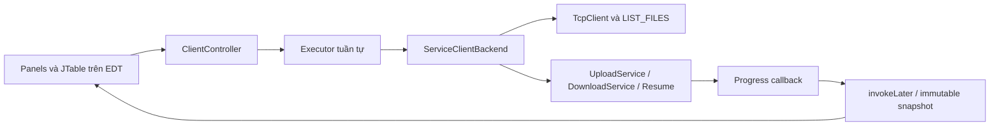

# Phase 8 — Java Swing Desktop Client

## A. Phạm vi

Nhánh `feature/tv3-client-transfer`, fast-forward từ `main` (`44fed4e`). README phân công client/network/transfer/UI cho TV3; tên nhánh TV4 có chữ UI nhưng không thay thế phân công trong README.

Đã có cửa sổ **LAN File Sharing**: kết nối IP/port, xem file completed, upload/download qua file chooser, progress/speed, log, ngắt kết nối và Resume trong lịch sử transfer. Không cần CLI để thao tác client. Server vẫn khởi động bằng script hiện có.

Theo yêu cầu chỉ làm giao diện cho backend đã có: **bỏ qua UDP Discover**, HTTP và các chức năng tương lai. Hiện repository chỉ có hằng số DiscoveryProtocol, chưa có discovery client/service để tích hợp; không tạo chức năng giả hoặc viết UDP mới.

## B. Cấu trúc và danh sách file

Tạo mới dưới `source/client/src/main/java/vn/edu/lanfileshare/client/ui/`:

| Trách nhiệm | Class |
| --- | --- |
| Entry point, cửa sổ và bố cục | `ClientSwingMain`, `MainFrame`, `UiTheme` |
| Panel | `ConnectionPanel`, `ServerFilePanel`, `TransferPanel`, `LogPanel` |
| Table model | `FileTableModel`, `TransferTableModel` |
| Điều phối, ranh giới service | `ClientController`, `ClientView`, `ClientBackend`, `ServiceClientBackend` |
| Dữ liệu trình bày | `Endpoint`, `UiState`, `UiSnapshot`, `TransferItem` |
| Hiển thị | `UiFormat`, `ErrorMessages` |

Tạo `run-swing.ps1`, `docs/phase8.md`; cập nhật README. Test mới: `ClientControllerIntegrationTest`, `UiModelsTest`, `DesktopSmokeTest` trong package test `client.ui`.

File backend duy nhất chỉnh sửa là `client/network/TcpClient.java`: socket reference thành volatile và thêm `interruptConnection()`. Hàm này chỉ đóng socket hiện tại, không chờ monitor đang bị giữ trong exchange; worker vẫn xử lý lỗi, checkpoint và state theo code Phase 5. Cần thiết để Disconnect/đóng window không chờ read timeout 30 giây. Không sửa TCP codec, DTO, upload/download service, resume algorithm, server hoặc dependency Maven.

## C. Tích hợp service và xử lý state



- Một executor daemon chạy connect/list/hash/upload/download/resume; `busy` được đặt trên EDT trước khi submit nên không thể khởi động transfer thứ hai hoặc refresh trong khi truyền.
- Mọi thay đổi model/controller và Swing component chạy trên EDT. Worker gửi kết quả bằng `invokeLater`; progress giới hạn khoảng một lần mỗi 80 ms, cộng sự kiện verify/completion. Không gửi callback cho từng byte, không giả lập tiến độ.
- Control executor riêng đóng socket khi bấm Disconnect trong transfer; không cần chờ khóa `TcpClient.exchange()`. Không gửi CANCEL hoặc frame mới.
- Đóng window đang bận hỏi người dùng rồi dispose. Socket đóng trên control thread; worker shutdown có thứ tự, không interrupt FileChannel đang ghi checkpoint. Worker/control đều daemon; kết quả muộn không cập nhật cửa sổ đã đóng. `termination()` cho phép kiểm thử chờ tài nguyên mạng được giải phóng, không chặn EDT.
- Không làm I/O mạng, full hash, đọc/ghi file lớn trên EDT. Local chooser là Swing chuẩn. Kích thước nguồn đọc trên worker và hiển thị trước khi tính hash.

State giao diện gồm Disconnected, Connecting, Connected, Uploading, Downloading, Verifying, Interrupted, Resuming, Completed, Failed. Discovering không xuất hiện vì discovery chưa triển khai. `connected` và `busy` tách khỏi trạng thái transfer: ví dụ Completed vẫn có socket và cho phép Refresh.

**Connect/list:** validate host/port tại controller → `TcpClient.connect()` ở worker → `listFiles()` → table thực tế. Danh sách rỗng hiển thị “No files”. Bảng sắp xếp số theo numeric size, giữ fileId phân biệt tên trùng, có SHA-256 ở chi tiết. Download chỉ enabled sau khi chọn hàng, dùng đúng model index khi bảng được sort.

**Upload:** chọn nguồn → hiển thị tên/dung lượng và bước tính SHA-256 → gọi UploadService → progress từ ACK thật → chỉ Completed sau khi service trả kết quả đã xác nhận TRANSFER_COMPLETE. Upload thành công tự refresh; nếu refresh riêng thất bại vẫn giữ transfer Completed và log lỗi refresh, không đảo ngược kết quả upload.

**Download:** chọn fileId → chọn đường dẫn đích local → gọi DownloadService → nhận progress → Verifying → Completed sau khi service verify/publish và gửi COMPLETE theo v1. Tên gợi ý mặc định `download-<fileId>.bin`; người dùng đặt tên mong muốn. Không dùng server name làm đường dẫn. Không ghi đè file có sẵn. Cơ chế publish/hard link, hash và `.part` giữ nguyên Phase 4/5.

Progress UI chưa hoàn tất bị chặn tối đa 99.9%, kết quả trả về thành công mới đặt 100%/Completed. Upload backend hiện không có callback riêng đúng thời điểm server bắt đầu hash cuối; UI tiếp tục Uploading trong thời gian đợi xác nhận, không suy đoán đã thành công. Download có callback VERIFYING thực tế. Tốc độ tính từ delta byte/time của lần thử hiện tại, không cộng offset đã resume vào throughput của lần thử mới.

**Resume:** `TransferInterruptedException` cung cấp transferId, checkpoint, offset cho hàng Interrupted. Không xóa tiến độ khi disconnect/reconnect. Người dùng Connect lại cùng host/port, chọn transfer rồi Resume. Adapter gọi `resumeUpload(id, source, listener)` hoặc `resumeDownload(id, checkpoint, listener)`; không tạo INIT thay thế. Nếu resume query bị timeout hoặc SERVER_BUSY sau số retry hữu hạn, hàng vẫn Interrupted để thử lại; lỗi integrity/terminal chuyển Failed. Server khác endpoint bị chặn ở UI để tránh dùng nhầm transferId.

Thông báo lỗi dùng mapping có ý nghĩa cho connect/refused/timeout/disconnect, file tồn tại/không tìm thấy, permission denied, hash mismatch, transfer changed/expired, server busy. JOptionPane không hiện stack trace; console logger giữ exception cho debug, log UI giữ tóm tắt và thông tin transfer/checkpoint local.

## D. Build và chạy

Từ root repository, PowerShell:

```powershell
.\build.ps1 compile test package
# Terminal 1: giữ server chạy trong toàn bộ demo resume
.\run-server.ps1
# Terminal 2: mở desktop client
.\run-swing.ps1
# Kết nối LAN hoặc đổi cổng/thư mục checkpoint:
.\run-swing.ps1 -ServerHost 192.168.1.10 -Port 49000 -CheckpointDirectory runtime/client
```

Script tái sử dụng `scripts/java-launch.ps1` truyền tham số Unicode an toàn trên Windows; không dùng dependency mới. Có entry point `vn.edu.lanfileshare.client.ui.ClientSwingMain [host] [port] [checkpointDirectory]`. Khi chạy Java trực tiếp cần classpath gồm client/common và Jackson như script hiện có. API entry point mặc định dùng thư mục user home `.lan-file-sharing/client`; script mặc định runtime/client trong repository, ngoài source.

Không tự connect khi mở cửa sổ: kiểm tra IP/port rồi bấm Connect. Nếu server cũ vẫn chạy JAR trước Phase 5, dừng bằng Ctrl+C và khởi động lại bản đã build trước buổi báo cáo.

## E. Bằng chứng kiểm thử

Đã chạy `build.ps1 compile`, test riêng `ClientControllerIntegrationTest,UiModelsTest`, test riêng `DesktopSmokeTest`, và toàn reactor `build.ps1 compile test package`.

Toàn suite có **128 test**: common 14, server 25, client 89, không failure/error/skipped trên lần chạy toàn bộ thành công. Bao gồm 118 test backend cũ và 10 test mới (controller 6, model/error 3, desktop 1). JDK 23 compile release 21, Maven 3.9.11. Xem XML/text tại `source/*/target/surefire-reports/` và log lần build cuối `runtime/phase8-final-build.log`.

Build cuối BUILD SUCCESS lúc `2026-11-04T01:33:06+07:00`, 01:11 phút. `run-swing.ps1` cũng đã được gọi với `JAVA_TOOL_OPTIONS=-Djava.awt.headless=true` để kiểm tra classpath/entry point: exit 0 và thông báo yêu cầu display đúng dự kiến; kiểm tra JFrame thật được thực hiện riêng trong DesktopSmokeTest, không suy diễn từ lần gọi headless.

Sau chỉnh nhỏ tự scroll đến transfer mới, đã chạy lại `build.ps1 package -Dtest=DesktopSmokeTest,UiModelsTest -Dsurefire.failIfNoSpecifiedTests=false`: 4 test UI PASS, reactor BUILD SUCCESS lúc `01:35:55+07:00`. Log: `runtime/phase8-layout-check.log`.

Các bằng chứng mới qua **socket thật**, không mock networking:

| Kiểm tra | Bằng chứng |
| --- | --- |
| Upload/list/download 1 MiB qua controller | So sánh byte-for-byte và SHA-256; table có metadata thật |
| Upload 100 MiB | Byte gốc khớp completed file; SHA-256 `ff8466658d5cc7786fd9e602a041f803702cfddca510cdd27cb28bc37244d1e0` |
| EDT trong lúc truyền file lớn | Gate worker có xác định; EDT xử lý heartbeat dưới timeout 2 giây, không nhận thao tác thứ hai |
| Ngắt/resume upload 10 MiB | Gửi 3,145,728 byte trước ngắt và 7,340,032 byte sau resume, cùng transferId |
| Ngắt/resume download 10 MiB | Nhận 3,145,728 + 7,340,032 byte; final bytes/hash khớp |
| Server busy khi resume | Socket khác giữ lease thật; retry hết giới hạn vẫn giữ hàng có thể Resume; nhả lease rồi resume thành công |
| Server im lặng | Đóng controller giải phóng receive/socket trong timeout 3 giây thay vì đợi read timeout 30 giây |
| Lỗi/guards | Port sai, refused, refresh offline, chưa chọn download, destination conflict không làm hỏng file cũ |
| Cửa sổ thật | Display khả dụng; mở JFrame, bấm Connect/Upload/Download, chọn nguồn/đích bằng JFileChooser, verify 1 MiB, resize, Disconnect và đóng window |

`DesktopSmokeTest` thao tác Swing component và file chooser thật, tự xác nhận các message dialog trong test; không thay backend. Ảnh render content của cửa sổ sau upload/download: `source/client/target/swing-phase8.png`. Test này tự skip nếu môi trường headless; các test controller/model vẫn chạy không cần JFrame, toàn bộ I/O transfer vẫn dùng service/socket thật.

Một lần capture build bằng PowerShell 5.1 `*>` gặp NativeCommandError khi Maven ghi log lên stderr; đã đổi harness capture sang Python subprocess (không đổi build.ps1 hoặc backend). Lệnh build toàn bộ thông thường chạy được; không dùng lỗi capture này làm lý do bỏ test.

## F. Checklist demo và giới hạn còn lại

Chuẩn bị file nhị phân 100 MiB có sẵn trên máy trước buổi demo. Không cần đăng ký file bằng run-catalog để có dữ liệu: upload qua UI sẽ đưa file completed vào table.

Workspace hiện đã có `runtime/demo/sample-1MiB.bin` và `runtime/demo/sample-100MiB.bin` để chọn trong JFileChooser. Đây là dữ liệu demo local bị Git ignore, không đưa file 100 MiB vào commit và không phải dependency của ứng dụng.

1. Chạy server, mở `run-swing.ps1`, bấm Connect tới `127.0.0.1:49000`. Kiểm tra Connected và danh sách/no files.
2. Upload file 1 MiB, sau đó 100 MiB. Quan sát tên, size, progress, speed, trạng thái và auto refresh. Di chuyển/resize window khi truyền để kiểm tra tương tác bằng tay.
3. Chọn file, Download, nhập tên đích mới và đợi SHA-256 verified. Thử lại cùng đích: phải báo lỗi, file cũ giữ nguyên.
4. Với file đủ lớn, bấm Disconnect khi đang truyền. Chờ Interrupted/checkpoint saved, bấm OK, Connect lại cùng IP/port, chọn hàng Interrupted rồi Resume. Không khởi động lại server.
5. Thử cả upload và download resume; kiểm tra Transfer ID không đổi và log giữ offset. Truyền localhost có thể nhanh: dùng file lớn hoặc hai máy LAN để có thời gian bấm. Test tự động đã ngắt theo callback xác định, không dựa vào thao tác tay.
6. Nhập port không phải số, cổng chưa có server; kiểm tra thông báo. Download/Refresh bị disable khi không đủ điều kiện; controller cũng có guard cho lời gọi trực tiếp.
7. Đóng window lúc idle và đang bận (xác nhận hộp thoại), kiểm tra process kết thúc. Thử trên máy Windows thực tế với folder không có quyền ghi, mạng LAN/firewall và DPI màn hình dùng báo cáo.

Các bước người dùng bấm chuột trực tiếp trên hai máy LAN, ACL từ chối ghi thực tế và nhiều mức DPI vẫn cần kiểm tra thủ công; không đánh dấu những phần đó đã PASS chỉ từ test loopback. Automated desktop đã chạy trên display thật nhưng không thay thế đánh giá UX của người dùng.

Giới hạn kế thừa: session server chỉ trong cùng tiến trình, TTL 24 giờ; không có resume sau server restart. Lịch sử UI hiện trong bộ nhớ cửa sổ, chưa có màn hình import checkpoint sau khi khởi động lại app; checkpoint Phase 5 vẫn giữ trên đĩa, không bị xóa. Resume qua UI hỗ trợ reconnect trong cùng lần mở app. Không thêm protocol CANCEL, quota, UDP, HTTP hoặc tính năng backend mới. Download completed vẫn theo semantics v1: client verify/publish và gửi COMPLETE, không có server ACK mới.

## G. Interface mở rộng

- `ClientBackend` là ranh giới service để gắn discovery sau này mà không đưa stream/frame vào UI.
- `ClientController` cung cấp connect, disconnect, refresh, upload, download, resume, snapshot, close và termination. Các thao tác/snapshot gọi trên EDT; backend chạy ở executor.
- `ClientView` nhận render/log/notice/closed trên EDT; `UiSnapshot`/`TransferItem` immutable.
- Khi Phase discovery có service thực tế, bổ sung worker Discover và lựa chọn endpoint tường minh; không tự connect server đầu tiên.

## H. Kết luận

**READY cho bản Swing demo các backend Phase 1–5 đang có**, với giới hạn bỏ qua discovery và checklist LAN/UX thủ công nêu trên.
